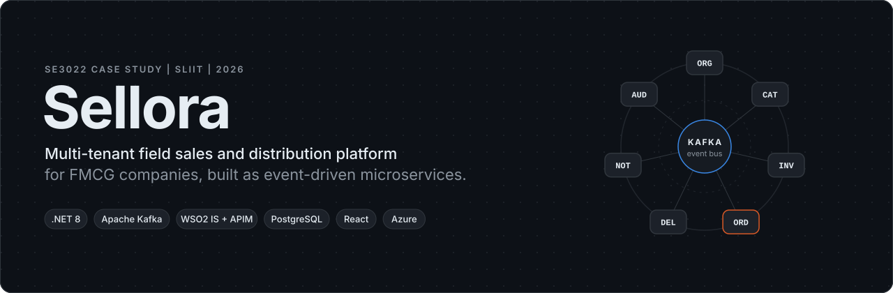
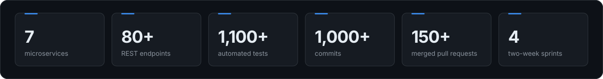
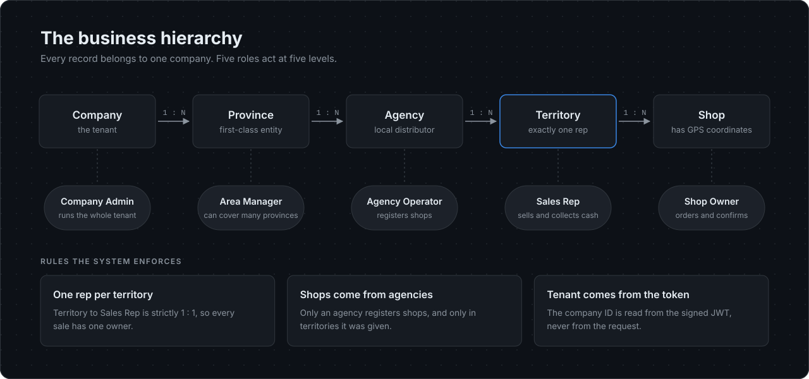
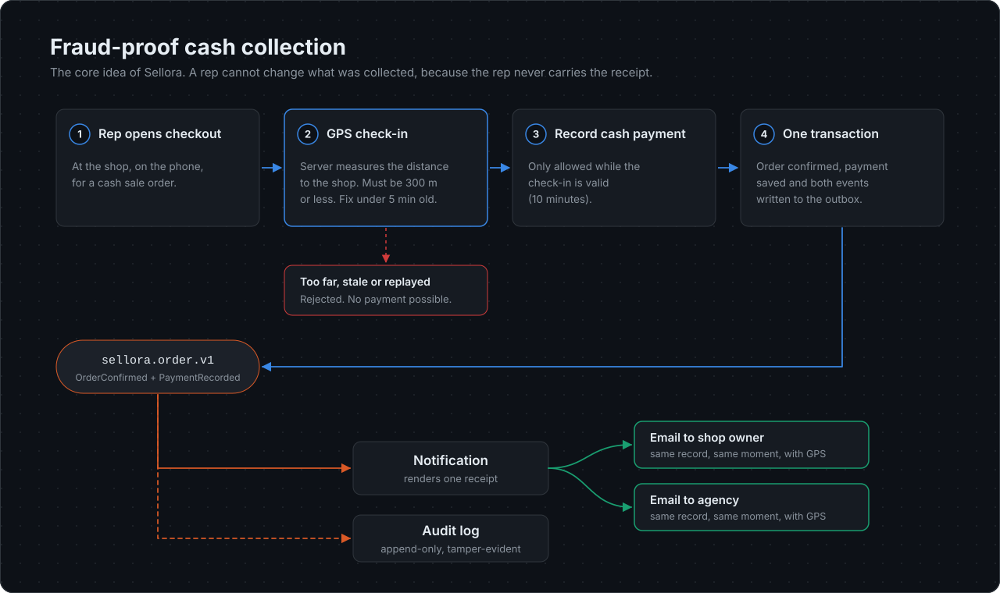
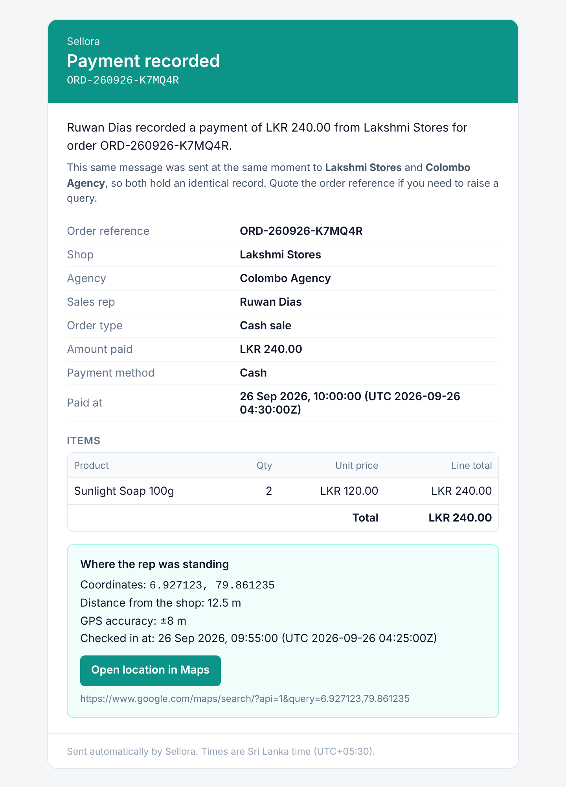
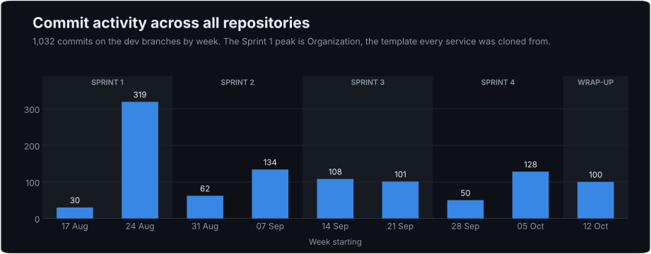
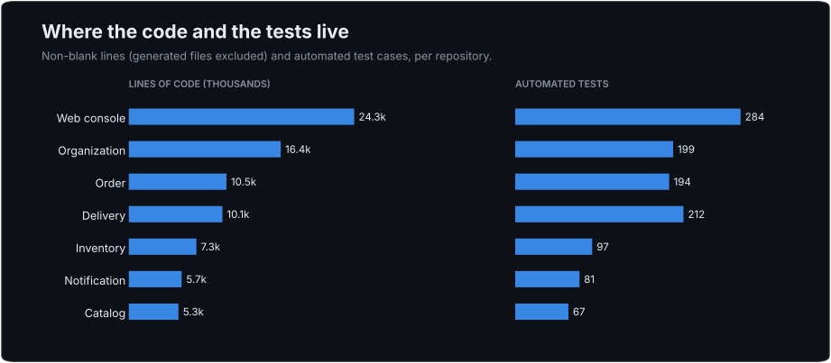

  

  
  
  
  
  
  
  

  <b>A showcase of the Sellora project.</b> 
  This repository explains the whole system in one place. It holds diagrams, design notes and selected code. 
  The full source lives in the service repositories under <a href="https://github.com/Team-Sellora">Team-Sellora</a>.

 

  

## Contents

| Section | What you will find |
|---|---|
| [The problem](#the-problem) | Why Sellora exists |
| [How the business is modelled](#how-the-business-is-modelled) | Companies, provinces, agencies, territories and shops |
| [Architecture](#architecture) | The big picture in one diagram |
| [The services](#the-services) | What each of the seven services owns |
| [Event-driven design](#event-driven-design) | How services talk without waiting on each other |
| [Fraud-proof cash collection](#fraud-proof-cash-collection) | The feature the whole system is built around |
| [Identity and security](#identity-and-security) | Who you are, what you can see |
| [Delivery pipeline](#delivery-pipeline) | From pull request to production |
| [By the numbers](#by-the-numbers) | Charts built from the real git history |
| [How we worked](#how-we-worked) | Sprints, rotating roles and the team |
| [Code highlights](#code-highlights) | Short excerpts worth reading |
| [Deep dives](#deep-dives) | Longer documents for each topic |

 

## The problem

FMCG companies sell soap, biscuits and drinks through a long chain. Head office supplies regional **agencies**. Agencies send **sales reps** to small **shops**. Reps take orders and often collect cash on the spot.

That last step is where money goes missing. A rep can collect 5,000 rupees and report 4,000. The shop has no receipt. The agency only hears the rep's version.

**Sellora closes that gap.** When a rep collects cash, the system checks the rep is physically at the shop. It then sends the **same receipt to the shop and the agency at the same moment**, with the GPS location attached. It also writes the payment to an audit log nobody can edit. The rep never carries the receipt, so the rep cannot change it.

Around that core, Sellora runs the rest of a distribution business: the sales hierarchy, the product catalogue, stock at every level, orders, deliveries, returns, notifications and reports.

 

## How the business is modelled

Sellora is **multi-tenant**. Many companies share one deployment, and each company only ever sees its own data. Inside a company the hierarchy is strict. Some rules are enforced in code because the business depends on them:

- **One sales rep per territory.** Every sale has exactly one accountable person.
- **Only agencies register shops**, and only inside territories assigned to them.
- **Orders are never split.** If the agency has every item in full, the agency supplies it. If not, the whole order comes from company stock. This keeps delivery and accounting simple.
- **Shops can cancel within one hour.** After that the order is locked. The window is a setting, not a constant.

 

## Architecture

Three ideas shape the design.

1. **Every request enters through one door.** The browser signs in with WSO2 Identity Server and calls APIs only through WSO2 API Manager. The gateway checks the token before any service sees the request.
2. **Each service owns its data.** There are seven .NET services and each has its own PostgreSQL database. No service reads another service's tables.
3. **Services share facts, not calls.** Only the Order service calls others directly, because it must check prices, stock and the rep's territory before it accepts an order. Everything after that travels as events through Kafka.

Every service follows the same internal layout (`Api`, `Application`, `Domain`, `Infrastructure`). This was set by a shared service template in Sprint 1. A developer moving between services finds the same structure, the same auth setup and the same outbox.

More detail: [docs/architecture.md](docs/architecture.md)

 

## The services

| Service | What it owns | Produces | Consumes |
|---|---|---|---|
| **Organization** | Companies, provinces, agencies, territories, shops and staff. Creates user logins in WSO2. Answers "where does this user sit?" | `sellora.hierarchy.v1` | |
| **Catalog** | Products, categories and prices with a full price history | `sellora.catalog.v1` | |
| **Inventory** | Stock per owner (company, agency, van). Reservations. Agency or company fulfilment. Low stock alerts | `sellora.inventory.v1` | hierarchy, order, delivery |
| **Order** | Orders, agency approval, cancellations, GPS check-in, cash payments and van returns | `sellora.order.v1` | |
| **Delivery** | Delivery jobs, rep assignment, status changes, live location, shop confirmation and shop returns | `sellora.delivery.v1` | order |
| **Notification** | Email receipts and alerts. Retries with backoff. A screen for failed emails with resend | | order, inventory, delivery |
| **Audit & Reporting** | An append-only, tamper-evident log of every business event. Sales dashboards and exports | | all five topics |

The **web console** is a React 19 app. It has around 30 screens and shows each of the five roles only what that role may use.

More detail: [docs/services.md](docs/services.md)

 

## Event-driven design

Events make the system resilient. If Notification is down, orders still go through. The emails go out when it comes back.

Four rules make that safe:

| Rule | Why it matters |
|---|---|
| **Transactional outbox** | An event is saved in the same database transaction as the change it describes. If the order is saved, the event will be published, even if Kafka is down at that moment. |
| **Ordered per key** | Events are keyed by order reference. `OrderConfirmed` can never arrive after the `PaymentRecorded` that follows it. |
| **Deduplication** | Kafka may deliver a message twice. Each consumer records the event ID and processes it only once. |
| **Dead-letter topics** | A message that cannot be read is parked on its own topic. It never blocks the messages behind it. |

Every event contract is versioned and documented in the producing repository.

More detail: [docs/events.md](docs/events.md)

 

## Fraud-proof cash collection

<table>
<tr>
<td width="55%" valign="top">

### What the server checks

| Check | Rule |
|---|---|
| Distance to the shop | 300 m or less, measured on the server |
| Age of the GPS fix | Less than 5 minutes old |
| Device clock | At most 2 minutes ahead |
| Check-in lifetime | Payment allowed for 10 minutes |
| Payment method | Cash only |

The distance uses the Haversine formula, rounded to the centimetre. That makes the 300 m boundary exact and repeatable. A point built exactly 300 m away is accepted every time.

The limits come from configuration. They can change without a redeploy.

### What the shop and the agency receive

The receipt on the right is real output from the Notification service. Both parties get this exact email at the same moment. It shows where the rep was standing and how far that was from the shop.

If the email provider fails, the service tries up to five times with growing gaps. A wrong address fails at once instead of wasting retries. An admin can see every failed email and resend it.

</td>
<td width="45%" valign="top">

</td>
</tr>
</table>

More detail: [docs/fraud-proof-checkout.md](docs/fraud-proof-checkout.md)

 

## Identity and security

| Question | Answered by | How |
|---|---|---|
| Who are you? | WSO2 Identity Server | Sign in with Authorization Code + PKCE. The token carries the user ID, role and company. |
| Can you call this API? | WSO2 API Manager | Every API is published on the gateway and rejects calls without a valid token. |
| Which company's data? | Every service | The company ID is read from the signed token. It is never taken from the URL or the body. |
| Where do you sit in the hierarchy? | Organization | `GET /api/me/scope` looks up the user by token subject. Services that need it cache the answer for five minutes. |
| What can you do here? | Every service | Role policies on each endpoint. The web console mirrors them so users never see buttons they cannot use. |

A design change in Sprint 3 is worth calling out. At first, database IDs such as the rep ID were copied into the user's token claims by hand. That was slow and easy to get wrong. We moved that knowledge into the Organization service. Organization now creates the WSO2 login itself over SCIM2 and answers scope questions from its own data. Nobody opens the WSO2 console to onboard a user any more.

More detail: [docs/security.md](docs/security.md)

 

## Delivery pipeline

Every service repository uses the same workflow set. **CI** runs on every push and pull request. It builds the service and runs the tests against real PostgreSQL and Kafka containers. It measures coverage and sends the results to SonarQube Cloud. It then builds the Docker image and checks that the service starts and reports healthy. **CD to staging** runs on every merge into `dev`. **CD to production** runs on every merge into `main`. Both deployments wait for the new container and then call its health endpoint before they report success.

More detail: [docs/devops.md](docs/devops.md)

 

## By the numbers

These charts come straight from the git history of the development branches.

Integration tests in all six backend services run against real databases with **Testcontainers**. The web console has its own unit tests with **Vitest**.

More detail: [docs/testing.md](docs/testing.md)

 

## How we worked

We worked in **four two-week sprints** with Jira for the backlog. Each member rotated through four roles: **Business Analyst / Project Manager, Developer, QA and DevOps**. Everyone had to understand the system from every side.

| Sprint | Epics delivered | Focus |
|---|---|---|
| **1** | E0 Platform, E1 Organization | WSO2 setup, service template, hierarchy and roles |
| **2** | E2 Catalog, E3 Inventory | Products, prices, stock and the fulfilment rule |
| **3** | E4 Order, E5 Notification | Ordering, GPS checkout, cash, receipts and retries |
| **4** | E6 Delivery and Returns, E7 Audit and Reporting | Delivery tracking, returns, audit log and dashboards |

Branches, commits and pull requests all carry the Jira key (for example `CSP-251`). Each story has its own design note in the repository that implemented it.

### Team

| Member | GitHub | Most of their commits went to |
|---|---|---|
| Maheesha Pramuditha | [@Maheesh09](https://github.com/Maheesh09) | Order, Notification, platform setup, identity and scope |
| Gayuth Waidyaratne | [@Gayuth-W](https://github.com/Gayuth-W) | Organization, web console |
| Naveen Tharuka | [@NaveenTharuka](https://github.com/NaveenTharuka) | Catalog, Inventory |
| Sihan Udayaratna | [@SihanUdayaratna03](https://github.com/SihanUdayaratna03) | Delivery, web console |

Roles rotated every sprint, so every member also tested, deployed and planned work for the others.

 

## Code highlights

Short excerpts from the real code base. Each file names the repository and path it came from.

| File | What it shows |
|---|---|
| [01-gps-check-in.cs](highlights/01-gps-check-in.cs) | The distance formula and the configurable check-in limits |
| [02-transactional-outbox.cs](highlights/02-transactional-outbox.cs) | Publishing events in order, safely, from several instances |
| [03-tenant-from-token.cs](highlights/03-tenant-from-token.cs) | Reading the company from the token and failing closed |
| [04-all-or-nothing-fulfilment.cs](highlights/04-all-or-nothing-fulfilment.cs) | Agency stock first, then the whole order from the company |
| [05-delivery-state-machine.cs](highlights/05-delivery-state-machine.cs) | Allowed delivery status changes as data |
| [06-email-retry-policy.cs](highlights/06-email-retry-policy.cs) | Which email failures to retry, and how long to wait |
| [07-route-access.ts](highlights/07-route-access.ts) | How the web console mirrors server-side role rules |

 

## Deep dives

| Document | Read it to learn |
|---|---|
| [Architecture](docs/architecture.md) | Request lifecycle, service layout, hosting |
| [Services](docs/services.md) | Every service, its endpoints and its events |
| [Events](docs/events.md) | Topics, contracts, guarantees and a sample payload |
| [Fraud-proof checkout](docs/fraud-proof-checkout.md) | The checkout sequence step by step |
| [Security](docs/security.md) | Identity, tenancy, roles and supply chain checks |
| [DevOps](docs/devops.md) | Pipelines, environments and the hosting decisions we had to make |
| [Testing](docs/testing.md) | Test strategy and where the tests live |
| [Design decisions](docs/decisions.md) | The choices we made, and why |
| [Glossary](docs/glossary.md) | Plain-language meaning of every term used here |

 

## Repository map

| Repository | Contents |
|---|---|
| `sellora-organization` | Organization service (.NET) |
| `sellora-catalog` | Catalog service (.NET) |
| `sellora-inventory` | Inventory service (.NET) |
| `sellora-order` | Order service (.NET) |
| `sellora-delivery` | Delivery service (.NET) |
| `sellora-notification` | Notification service (.NET) |
| `sellora-audit` | Audit and Reporting service (.NET, not public) |
| `sellora-web` | Web console (React, TypeScript) |
| `sellora-infra` | Local Kafka and databases, WSO2 setup scripts, shared event schemas |
| **this repository** | The showcase: diagrams, documents, selected code and the scripts that draw the visuals (`tools/`) |

 

## About this repository

Sellora was built for the **SE3022 Case Study** module at the **Sri Lanka Institute of Information Technology (SLIIT)** in 2026. The hosted environments were shut down when the project ended.

This repository does not contain the full source code. The code excerpts are shared for learning and portfolio purposes only. All rights are reserved by the authors.

Built by Team Sellora

