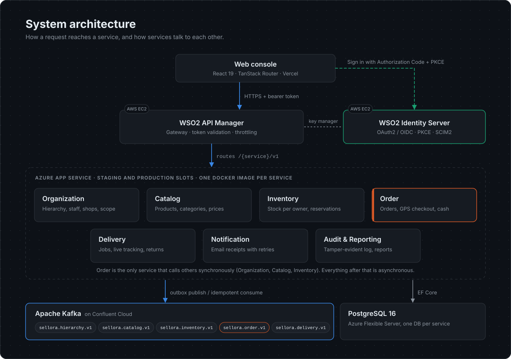
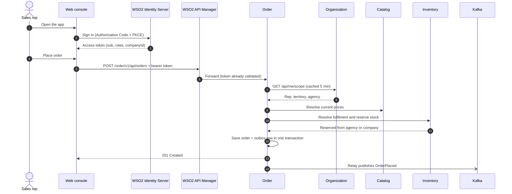
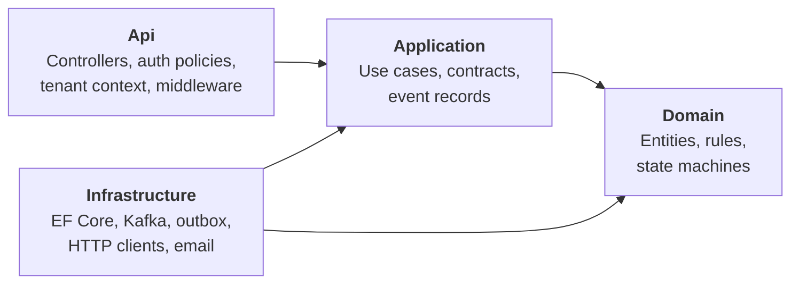

# Architecture

[Back to overview](../README.md)

## The layers

| Layer | Technology | Job |
|---|---|---|
| Client | React 19, TanStack Router, React Query, Tailwind | The web console for all five roles |
| Identity | WSO2 Identity Server 7 | Users, roles, sign-in, tokens, user provisioning over SCIM2 |
| Gateway | WSO2 API Manager 4 | One entry point for every API. Validates tokens with Identity Server as its key manager |
| Services | ASP.NET Core Web API on .NET 8, EF Core | Seven services, each owning one part of the business |
| Messaging | Apache Kafka on Confluent Cloud | Events between services |
| Data | PostgreSQL 16 on Azure Flexible Server | One database per service |

## The life of a request

This is what happens when a sales rep places a cash sale order.

Steps 8 to 10 are the only synchronous calls between services in the whole system. Order needs those answers before it can say yes. Everything after step 11 is asynchronous.

The service forwards the caller's own token on those calls. Each downstream service applies its own role and tenant rules. No service has a hidden super-user path.

## Inside a service

Every service has the same four projects. This layout came from a shared template built in Sprint 1.

- **Domain** has no framework code. Rules like the GPS radius or allowed delivery transitions live here and are easy to unit test.
- **Application** defines what the service does through interfaces.
- **Infrastructure** implements those interfaces with real technology.
- **Api** wires everything together and exposes HTTP.

Tenant-owned entities carry the company ID, and each service's EF Core context applies a global query filter on it. A query cannot forget the tenant check, because the filter adds it automatically. If the token has no valid company, the filter matches nothing and the service returns no rows.

## Hosting

| Component | Where it ran | Notes |
|---|---|---|
| Web console | Vercel | One gateway URL per service, set as environment variables |
| WSO2 IS and APIM | AWS EC2 (t3.large) | Moved from Oracle Cloud mid-project when the free tier was withdrawn |
| Services | Azure App Service | Docker images from Docker Hub. Staging and production slots per service |
| Databases | Azure Database for PostgreSQL Flexible Server | One database per service |
| Kafka | Confluent Cloud | Moved from a self-hosted broker. SASL is switched on by configuration |
| Email | Brevo SMTP | Mailpit locally and in tests |
| Maps | Google Maps JavaScript API | Browser key restricted by referrer and API |

## Local development

`sellora-infra` runs the shared pieces with Docker Compose: Kafka, ZooKeeper and the PostgreSQL databases. Each service repository also has its own `docker-compose.yml` so a developer can run one service in isolation.

Every setting comes from configuration. The same image runs locally, in staging and in production. Only the environment variables change.
