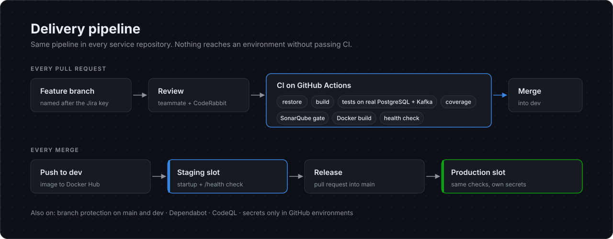
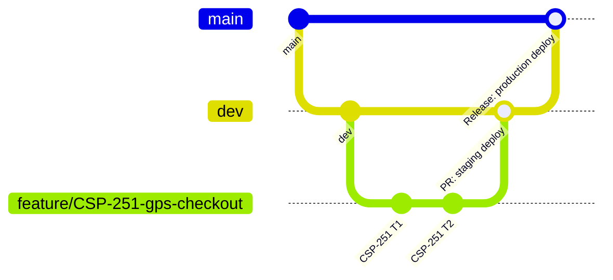

# DevOps

[Back to overview](../README.md)

## Branches

- **Feature branches** are named after the Jira key, for example `feature/CSP-251-GPS-and-payment-recording`.
- **`dev`** is the integration branch. Every merge deploys to staging.
- **`main`** is production. Every merge deploys to production.
- Both are protected. Changes arrive only through reviewed pull requests with green CI.

## Continuous integration

Every .NET service uses the same reusable workflow pattern. Each repository calls it with its own solution path.

| Step | What it proves |
|---|---|
| Restore and build | The solution compiles from a clean checkout |
| Start PostgreSQL 16 and Kafka | Tests run against real infrastructure, not mocks |
| Tests with coverage | Unit and integration tests pass. Coverage is collected |
| SonarQube Cloud | Quality gate on bugs, code smells, security hotspots and coverage |
| Docker build | The image builds (in five of the six services) |
| Health check | The container starts and answers `/health` |

## Continuous delivery

| Stage | Trigger | Steps |
|---|---|---|
| Staging | Push to `dev` | Build and push the image to Docker Hub. Azure pulls it into the staging slot. Poll `/health` and `/whoami` until both answer |
| Production | Push to `main` | Same image flow into the production slot with production secrets |

The CD job only reports success after the new container answers. A deployment that starts but cannot reach its database fails the pipeline.

## Hosting decisions under real limits

This was a student project on student cloud accounts. Several constraints forced real engineering decisions.

| Problem | Decision |
|---|---|
| The Oracle Cloud free tier that hosted WSO2 was withdrawn mid-project | Moved WSO2 Identity Server and API Manager to an AWS EC2 t3.large and reconnected every service |
| Kafka ran on a self-managed broker on EC2 | Moved to managed Confluent Cloud. SASL turns on only when credentials are configured, so local development still uses plain Docker Kafka |
| The Azure App Service plan ran out of memory with eight apps and slots | Scale up was blocked by zero Premium quota on the student subscription. Services run as container web apps from Docker Hub images, and we planned capacity before adding Delivery and Audit |
| The university's Azure tenant blocks OIDC federated credentials and service principals | Deployed with per-app publish profiles stored as GitHub secrets |
| Credits ran low near the end | Planned the final sprint's environments around the remaining budget |

None of these were in the plan. Each one had to be diagnosed, decided and rolled out while the sprint continued.

## Local development

| Piece | How |
|---|---|
| Kafka and ZooKeeper | `sellora-infra/docker-compose.yml` |
| Databases | PostgreSQL 16 containers, one per service |
| Email | Mailpit catches every email locally |
| WSO2 | Shell scripts in `sellora-infra` seed the five roles and test users and configure the apps |
| A single service | Each repository has its own `docker-compose.yml` |

## Repository hygiene

- A pull request template in every repository.
- `CODEOWNERS` in the Order, Notification and web repositories.
- Each story has a design note under `docs/US-E*.md` in the repository that implemented it.
- Each event contract is documented under `docs/contracts/` in the producing repository. Shared JSON schemas live in `sellora-infra/contracts`.
