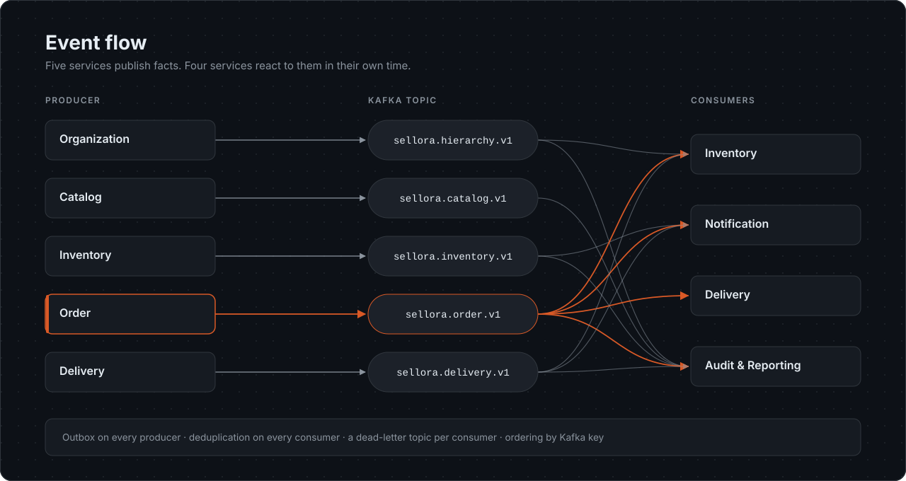
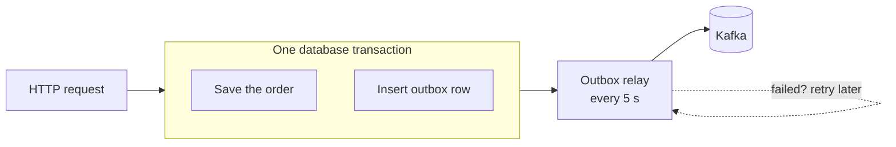

# Events

[Back to overview](../README.md)

<p align="center"></p>

## Why events

Most work in Sellora happens **after** an order is accepted. Stock must move. Emails must go out. A delivery job must exist. The audit log must record it all.

If Order called each of those services directly, one slow email provider would make checkout slow. One broken service would block every sale. Events remove that coupling. Order records a fact once and moves on. Every interested service reacts in its own time.

## Topics

| Topic | Producer | Events | Consumed by |
|---|---|---|---|
| `sellora.hierarchy.v1` | Organization | `AgencyRegistered`, `ShopRegistered`, `ShopUpdated`, `SalesRepAssigned`, `HierarchyEntityDeactivated` | Inventory, Audit |
| `sellora.catalog.v1` | Catalog | `PriceChanged` | Audit |
| `sellora.inventory.v1` | Inventory | `LowStockDetected` | Notification, Audit |
| `sellora.order.v1` | Order | `OrderPlaced`, `OrderApproved`, `OrderConfirmed`, `PaymentRecorded`, `OrderCancelled`, `VanStockReturned` | Inventory, Notification, Delivery, Audit |
| `sellora.delivery.v1` | Delivery | `DeliveryJobCreated`, `DeliveryStatusChanged`, `DeliveryConfirmed`, `ReturnRequested`, `ReturnAccepted`, `ReturnRejected` | Inventory, Notification, Audit |

Each consumer also has its own dead-letter topic, for example `sellora.notification.dead-letter.v1`.

The `.v1` suffix is the contract version. A breaking change would go to a new topic so old consumers keep working.

## The guarantees

### 1. No change without its event

Producers never call Kafka inside a request. They write the event to an **outbox table** in the same database transaction as the business change. A background relay publishes committed rows.



If the transaction rolls back, there is no event. If it commits, the event will be published, even if Kafka was down at that moment.

### 2. Events of one order stay in order

Every order event uses the **order reference as its Kafka key**, so they land on one partition in order. The relay adds one more rule. It never publishes an event while an earlier event for the same key is still waiting. Without that rule a failed `OrderConfirmed` could be overtaken by its `PaymentRecorded`.

Rows are **leased** with a conditional update before publishing. Two relay instances can never publish the same row.

See [highlights/02-transactional-outbox.cs](../highlights/02-transactional-outbox.cs).

### 3. Each event is processed once

Kafka delivers at least once, so a consumer may see the same message twice. Every consumer records the `eventId` it has handled. Notification uses a unique index on the source event ID. Inventory checks a processed-events table before it changes stock. A duplicate does nothing.

### 4. Bad messages never block good ones

A message that cannot be parsed is moved to the consumer's dead-letter topic with the error. The consumer commits past it and carries on.

## Message format

| Part | Content |
|---|---|
| Key | The aggregate reference, for example `ORD-260926-K7MQ4R` |
| Value | Flat JSON, camelCase, no envelope |
| Headers | `event-id`, `event-type`, `schema-version`, `company-id`, `correlation-id` |

Events carry the names and emails a consumer needs. Notification can send a receipt without calling any other service.

## Sample: `PaymentRecorded`

All values below are sample data.

```json
{
  "eventId": "4f3b2a10-7c1e-4d55-9a0e-2b6f8c1d9e77",
  "eventType": "PaymentRecorded",
  "schemaVersion": "1.0",
  "companyId": "0b6f1c2e-91a4-4a8e-8f3e-6a2d7c5b1e90",
  "orderId": "a1c9e4f2-3b7d-4e18-9c6a-5d2f8b0e7a13",
  "orderReference": "ORD-260926-K7MQ4R",
  "occurredAt": "2026-09-26T04:30:00Z",
  "correlationId": "8d2e6b1f4a7c4f0e",
  "fulfilmentType": "ImmediateCashSale",
  "status": "Confirmed",
  "shop": { "shopId": "…", "name": "Lakshmi Stores", "ownerName": "…", "ownerEmail": "…" },
  "agency": { "agencyId": "…", "name": "Colombo Agency", "email": "…" },
  "salesRep": { "salesRepId": "…", "name": "Ruwan Dias" },
  "lines": [
    { "productId": "…", "productName": "Soap 100g", "quantity": 2, "unitPrice": 120.00, "lineTotal": 240.00 }
  ],
  "subtotal": 240.00,
  "total": 240.00,
  "currency": "LKR",
  "payment": {
    "paymentId": "…",
    "amount": 240.00,
    "method": "Cash",
    "recordedAt": "2026-09-26T04:30:00Z",
    "checkInId": "…"
  },
  "checkInLocation": {
    "latitude": 6.927123,
    "longitude": 79.861235,
    "distanceMeters": 12.5,
    "accuracyMeters": 8,
    "checkedInAt": "2026-09-26T04:25:00Z"
  }
}
```

## When Order publishes what

| Transition | Events, in order |
|---|---|
| Cash sale accepted | `OrderPlaced` |
| Cash sale checked out and paid | `OrderConfirmed`, `PaymentRecorded` |
| Cash sale stock hold expired | `OrderCancelled` (source `StockHoldExpired`) |
| Scheduled delivery accepted | `OrderPlaced` |
| Agency approves | `OrderApproved`, `OrderConfirmed` |
| Agency rejects | `OrderCancelled` (source `AgencyRejection`) |
| Shop cancels inside the window | `OrderCancelled` (source `ShopCancellation`) |
| Van return accepted | `VanStockReturned` |
| Any rejected request | nothing |
