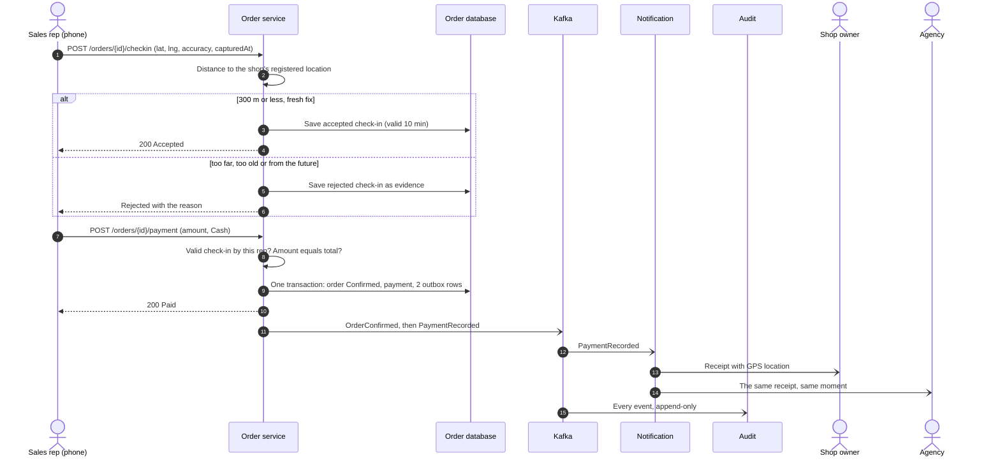

# Fraud-proof checkout

[Back to overview](../README.md)

## The idea in one sentence

**The rep collects the cash, but the system writes the receipt.** The shop and the agency receive the same record at the same moment, with the place it was collected. Nobody in the middle can change it.

## Step by step

## The rules

| Rule | Value | Why |
|---|---|---|
| Maximum distance from the shop | 300 m | Tight enough to prove presence, loose enough for GPS error in a busy street |
| Maximum age of the GPS fix | 5 minutes | An old fix cannot be replayed later from somewhere else |
| Maximum clock skew | 2 minutes ahead | A device cannot claim a time in the future |
| Check-in lifetime | 10 minutes | Enough time to count cash. Not enough to leave and come back |
| Who can pay | The rep who checked in | One rep cannot use another rep's check-in |
| Amount | Must equal the order total | The server computes the total. The phone cannot change it |
| Method | Cash only | The only method in scope |

All limits come from configuration. The radius can change without a new release.

## What the server refuses

| Failure | When |
|---|---|
| `CheckInRequired` | Payment sent with no accepted check-in |
| `CheckInExpired` | The check-in is older than 10 minutes |
| `WrongSalesRep` | Someone other than the order's rep tries to check in or pay |
| `CaptureTooOld` | The GPS fix is more than 5 minutes old |
| `CapturedInFuture` | The device clock is ahead by more than 2 minutes |
| `InvalidCoordinates` | Latitude or longitude out of range |
| `AmountMismatch` | Cash amount differs from the order total |
| `NotAwaitingCheckout` | The order is not waiting for payment |

Rejected check-ins are **stored, not discarded**. If a rep tries from 2 km away, that attempt is part of the record.

## Measuring distance

The server uses the Haversine formula with the mean Earth radius. At the 300 m scale it is accurate to well under a metre. PostGIS was not needed.

The result is rounded to the centimetre. That makes the boundary deterministic. A point exactly 300 m away measures 300.00 and is accepted every time, with no floating point surprises.

See [highlights/01-gps-check-in.cs](../highlights/01-gps-check-in.cs).

## The receipt

This is the real template rendered by the Notification service, with sample data. It states plainly that the same message went to both parties. It includes the coordinates, the distance from the shop, the GPS accuracy and a link to the map.

## When email fails

Each recipient is tracked on its own. If the agency's email fails, the shop's receipt still goes out.

| Failure type | Example | What happens |
|---|---|---|
| Temporary | Provider busy, network error, SMTP 4xx | Retry with exponential backoff and jitter. Up to 5 attempts |
| Permanent | Invalid address, SMTP 5xx hard bounce | Stop at once. Marked as permanently failed |
| Our configuration | Sender not verified, wrong SMTP key | Treated as temporary. Fixing the setting lets retries recover |

Company admins have a **Failed notifications** screen. It shows the exact provider response, a preview of the rendered email and a resend button.

See [highlights/06-email-retry-policy.cs](../highlights/06-email-retry-policy.cs).

## The audit trail

The Audit service writes every event to an append-only log. The running service can only insert and read. PostgreSQL refuses updates and deletes for that role. Entries are chained, so verification points to the exact entry that was altered or removed.
