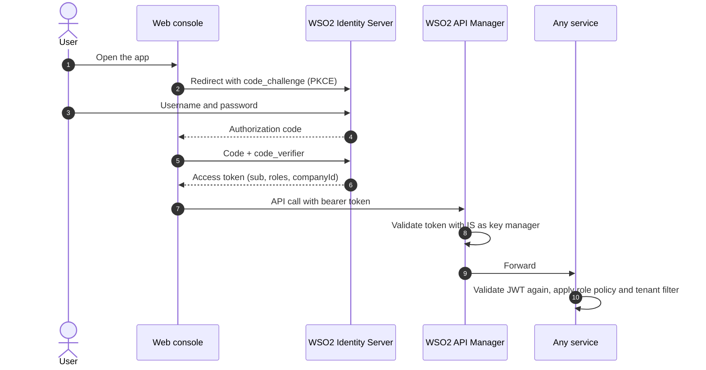

# Identity and security

[Back to overview](../README.md)

## Five roles

| Role | Typical person | Sees |
|---|---|---|
| Company Admin | Head office | The whole company |
| Area Manager | Regional manager | Their provinces |
| Agency Operator | Distributor's office | Their agency, its reps and shops |
| Sales Rep | Field rep | Their territory, their orders, their van |
| Shop Owner | The retailer | Their own shop's orders and deliveries |

## Signing in

- The browser is a **public client**. It has no secret to leak. PKCE proves that the app that started the login is the one finishing it.
- The token is checked twice. Once at the gateway and again inside the service. A service never trusts that a request came through the gateway.

## Tenant isolation

Sellora is shared by many companies. A leak between them would be the worst possible bug. Three layers stop it.

1. **The company comes from the token.** Each service reads `companyId` from the signed JWT. It is never read from a URL, a query string or a request body.
2. **Every query is filtered.** EF Core adds a global filter on the company ID to every tenant-owned table.
3. **Missing means nothing.** If the claim is absent or invalid, the tenant is `null` and the filter matches no rows. The service fails closed.

See [highlights/03-tenant-from-token.cs](../highlights/03-tenant-from-token.cs).

## Scope inside a company

Knowing the company is not enough. A rep must see only their territory. An Area Manager only their provinces.

The first version copied database IDs such as `salesRepId` into WSO2 user claims by hand. It worked, but every new user needed manual console work and a typo meant a broken login.

We replaced it in Sprint 3:

| Before | After |
|---|---|
| Admin creates a user in the WSO2 console | Admin adds the person in Sellora |
| Admin copies database IDs into custom claims | Organization creates the login over SCIM2 and links it to the profile |
| Services read IDs from the token | Services ask `GET /api/me/scope` and cache the answer for 5 minutes |
| A wrong claim gives a user the wrong data | Scope is derived on the server from the verified `sub` |

The provisioning client in WSO2 can only manage users and roles. It uses the client credentials grant and its secret lives only in App Service settings. The temporary password for a new user is returned once with `Cache-Control: no-store` and never saved.

## Roles on every endpoint

Each controller action has a named policy such as `RequireSalesRep` or `RequireAgencyOperator`. The web console mirrors those rules in its route guard, so people do not see buttons they cannot use. The server still checks every call. The console is a convenience, never the protection.

See [highlights/07-route-access.ts](../highlights/07-route-access.ts).

## Secrets

- No secret is committed. Repositories that need local settings ship an `.env.example` with placeholders.
- CI and CD read secrets from GitHub environments. Running services read them from App Service settings.
- The Google Maps key is a browser key, so it is visible by design. It is restricted to the Maps JavaScript API and to the Sellora domain and localhost.

## Code and supply chain

| Control | Where |
|---|---|
| Branch protection on `main` and `dev` | Every repository. Changes arrive by pull request only |
| Review by a teammate and CodeRabbit | Every pull request |
| SonarQube Cloud quality gate | Every .NET service CI run |
| CodeQL scanning | Order and Notification |
| Dependabot updates | NuGet packages in Catalog |
| Pinned action versions | Third-party GitHub Actions pinned to a commit SHA in CD |

## What we would do next

- Move the WSO2 servers behind a proper domain certificate everywhere, so no environment needs a self-signed certificate allowance.
- Add rate limits per tenant at the gateway.
- Rotate the provisioning secret on a schedule.
