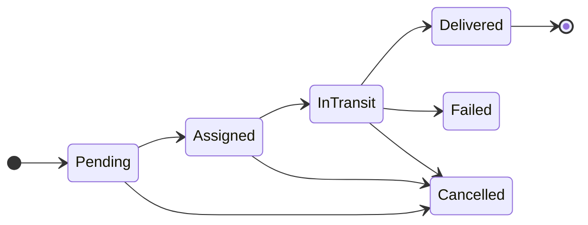

# The services

[Back to overview](../README.md)

Seven backend services and one web console. Each service is its own repository with its own database, pipeline and deployment.

| Service | Repository | REST endpoints | Automated tests |
|---|---|---|---|
| Organization | `sellora-organization` | 27 | 199 |
| Catalog | `sellora-catalog` | 14 | 67 |
| Inventory | `sellora-inventory` | 9 | 97 |
| Order | `sellora-order` | 11 | 194 |
| Delivery | `sellora-delivery` | 12 | 212 |
| Notification | `sellora-notification` | 7 | 81 |
| Audit & Reporting | `sellora-audit` (not public) | | |
| Web console | `sellora-web` | | 284 |

Counts come from the `dev` branches. Tests are counted as `[Fact]` and `[Theory]` methods in .NET and as `it` and `test` cases in Vitest.

 

## Organization

**Owns the business hierarchy and the people in it.**

- Companies, provinces, agencies, territories and shops as first-class records.
- Area Managers assigned to one or more provinces. Agencies registered by Area Managers. Shops registered by agencies inside their own territories.
- Strict one-to-one link between a territory and a sales rep.
- Creates user logins in WSO2 Identity Server over SCIM2 when an admin adds a staff member or a shop owner. The temporary password is shown once and never stored.
- Answers `GET /api/me/scope`, which tells any service where the caller sits in the hierarchy.
- Soft deactivation of hierarchy records with an audit entry, so history is never lost.

| Endpoint | Purpose |
|---|---|
| `GET /api/hierarchy` and `/roll-up` | The tree for the caller, and totals per level |
| `POST /api/agencies`, `/territories`, `/shops` | Register hierarchy records |
| `PUT /api/territories/{id}/sales-rep` | Assign the one rep for a territory |
| `POST /api/staff` | Create a staff member and their login in one step |
| `GET /api/me/scope` | Where the caller sits |
| `GET /api/rep-shop-relationships/verify` | Is this rep allowed to sell to this shop? |

**Publishes** `AgencyRegistered`, `ShopRegistered`, `ShopUpdated`, `SalesRepAssigned`, `HierarchyEntityDeactivated` on `sellora.hierarchy.v1`.

 

## Catalog

**Owns what the company sells and at what price.**

- Products and categories with create, update and deactivate. Category names are unique per company regardless of letter case.
- Price changes are kept as history. Every change is recorded with who made it and when.
- An internal endpoint gives Order the authoritative current price for a basket. Order never trusts a price sent by the browser.

| Endpoint | Purpose |
|---|---|
| `GET /api/products`, `/api/categories` | Browse the catalogue |
| `PUT /api/products/{id}/price` | Change a price |
| `GET /api/products/{id}/price-history` | Every past price |
| `POST /internal/catalog/products/resolve` | Prices for an order, used by Order |

**Publishes** `PriceChanged` on `sellora.catalog.v1`.

 

## Inventory

**Owns stock, wherever it sits.**

- Stock is held per **owner**: the company, each agency and each sales rep's van.
- Reservations hold stock for an order. They are confirmed, released or expire on their own if the order never completes.
- The **fulfilment resolver** applies the all-or-nothing rule. It tries to reserve the full basket from the agency. Only if the agency is short does it try the full basket from the company. It never splits.
- A reorder threshold per stock item. Falling below it raises `LowStockDetected`.
- Reacts to order, delivery and hierarchy events. Confirmed orders reduce stock. Cancelled orders and accepted returns put it back. A new agency or a newly assigned rep gets a stock owner automatically.

| Endpoint | Purpose |
|---|---|
| `GET /api/stock` | Stock the caller may see |
| `POST /api/stock/adjustments` | Manual adjustment with a reason |
| `POST /api/stock/fulfilment/resolve` | Agency or company, then reserve |
| `POST /api/stock/reservations/{id}/confirm` and `/release` | Finish or undo a reservation |

**Publishes** `LowStockDetected` on `sellora.inventory.v1`.

**Consumes** order events (`OrderConfirmed`, `OrderCancelled`, `VanStockReturned`), delivery events (`ReturnAccepted`) and hierarchy events (`AgencyRegistered`, `SalesRepAssigned`).

 

## Order

**Owns orders and the money collected for them.** It is the hub of the system.

- Two kinds of order. A **cash sale** is paid at the counter from stock in the rep's van. A **scheduled delivery** waits for the agency to approve it and is delivered later.
- Before accepting an order it confirms the rep may sell to the shop, fetches current prices and reserves stock.
- **GPS check-in and cash payment** for cash sales. See [fraud-proof checkout](fraud-proof-checkout.md).
- Shop owners can cancel inside a configurable window (one hour by default). Agencies approve or reject scheduled deliveries.
- **Van returns.** At the end of the day a rep declares unsold stock. The agency accepts what actually came back and the variance is recorded.

| Endpoint | Purpose |
|---|---|
| `POST /api/orders` | Place an order |
| `PUT /api/orders/{id}/approval` | Agency approves or rejects |
| `POST /api/orders/{id}/checkin` | GPS check-in at the shop |
| `POST /api/orders/{id}/payment` | Record cash, only with a valid check-in |
| `POST /api/orders/{id}/cancellation` | Shop owner cancels |
| `POST /api/van-returns` and `PUT .../acceptance` | Declare and accept van returns |

**Publishes** `OrderPlaced`, `OrderApproved`, `OrderConfirmed`, `PaymentRecorded`, `OrderCancelled`, `VanStockReturned` on `sellora.order.v1`.

 

## Delivery

**Owns getting goods to the shop, and getting them back.**

- A delivery job is created automatically when a scheduled order is confirmed.
- The agency assigns a rep from those eligible. The rep moves the job through its states.
- While a job is in transit the rep's phone shares its position every 30 seconds. The shop sees it on a map.
- The shop owner confirms receipt.
- Shops can request returns. The agency accepts or rejects them, and accepted stock goes back to the agency.

| Endpoint | Purpose |
|---|---|
| `PUT /api/deliveries/{id}/assignment` | Assign a rep |
| `PATCH /api/deliveries/{id}/status` | Move to the next allowed state |
| `POST` and `GET /api/deliveries/{id}/location` | Share and read live position |
| `POST /api/deliveries/{id}/confirmation` | Shop confirms receipt |
| `POST /api/returns` and `PUT .../decision` | Request and decide a return |

**Publishes** `DeliveryJobCreated`, `DeliveryStatusChanged`, `DeliveryConfirmed`, `ReturnRequested`, `ReturnAccepted`, `ReturnRejected` on `sellora.delivery.v1`.

 

## Notification

**Owns every email the system sends.**

- Turns order, delivery and stock events into emails. A payment sends one identical receipt to the shop and the agency at the same moment.
- Each recipient is tracked separately. A failure for one never blocks the other.
- Temporary failures are retried up to five times with exponential backoff and jitter. Permanent failures such as a bad address stop at once.
- Company admins see failed emails, read the exact provider response, preview the rendered email and resend it.
- Low stock alerts go to an address each company sets for itself.

| Endpoint | Purpose |
|---|---|
| `GET /api/notifications` | List notifications, filter by failed |
| `GET /api/notifications/{id}/rendered` | Preview the exact email |
| `POST /api/notifications/{id}/resend` | Try again after fixing the cause |
| `GET` and `PUT /api/notifications/settings` | Where alerts go |

 

## Audit & Reporting

**Owns the permanent record.**

- Reads every event from all five topics and stores it in an append-only log.
- The database role used by the running service may only insert and read. Update and delete are refused by PostgreSQL itself, not just by the code.
- Entries are linked so that any changed or missing entry is detected on verification.
- Search by order reference or date range, always scoped to the caller's company and province.
- Sales dashboards and exports are built from projections kept in a separate schema.

 

## Web console

**One React app for all five roles.**

- Built with React 19, TanStack Router and React Query, with shadcn/ui components and Tailwind.
- Signs in with `oidc-client-ts` using Authorization Code + PKCE.
- Each feature lives in its own folder with its API calls, hooks, types and tests.
- One gateway URL and one fetch helper per backend service.
- Route guards mirror the server's role rules, so users only see what they can use. The server still checks every call.

| Area | Screens |
|---|---|
| Hierarchy | Provinces, area managers, agencies, territories, assignments, shops, staff, roll-up |
| Catalogue and stock | Products, categories, inventory |
| Selling | Orders, new order, order detail, checkout, van returns |
| Delivery | Deliveries, delivery detail with live map, shop returns |
| Admin | Failed notifications, audit log, reports and exports |
